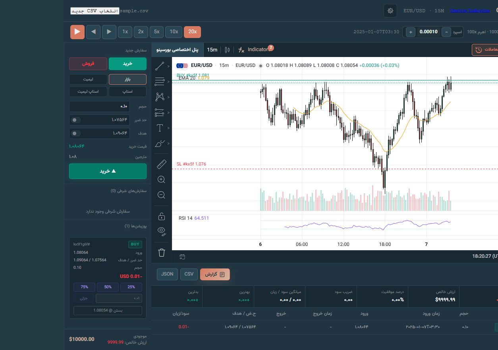
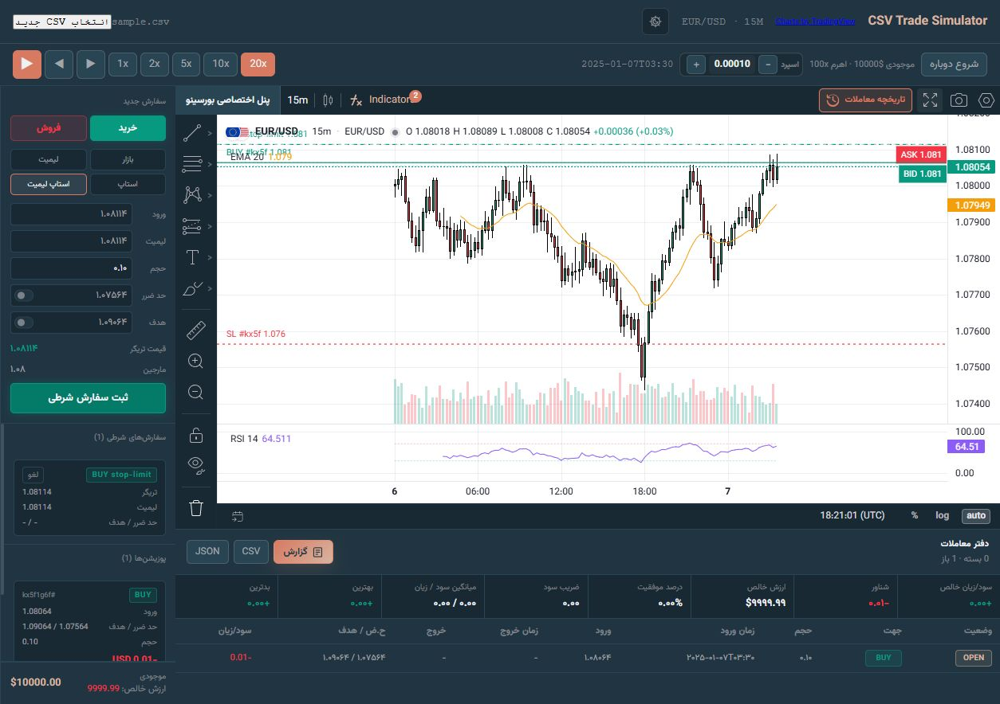
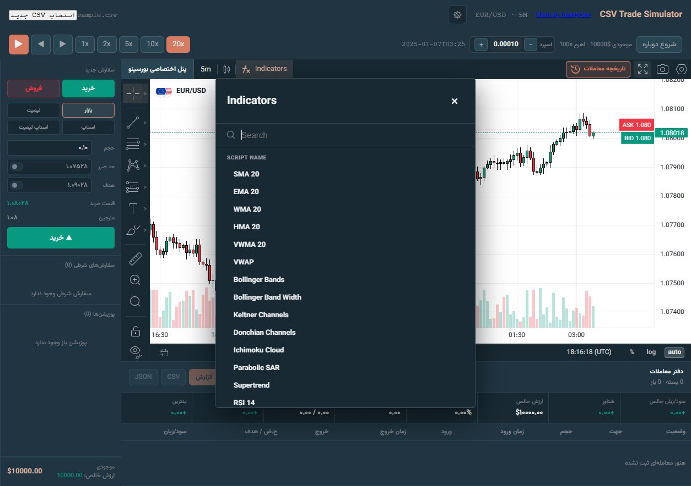
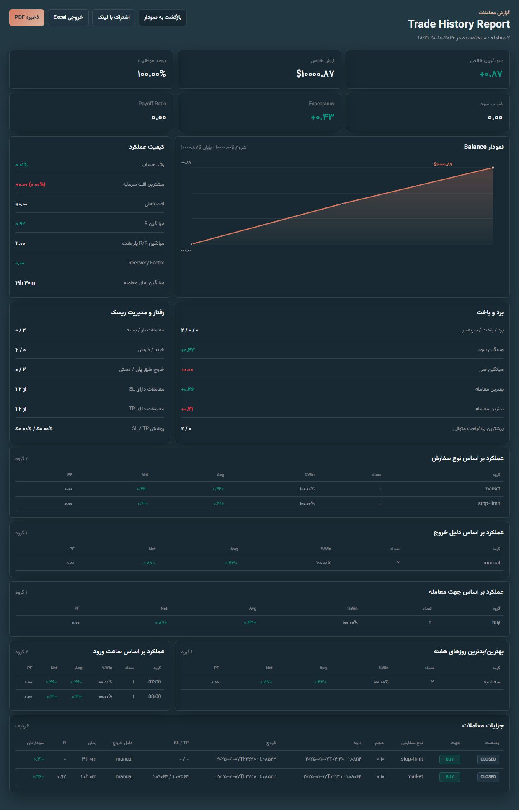
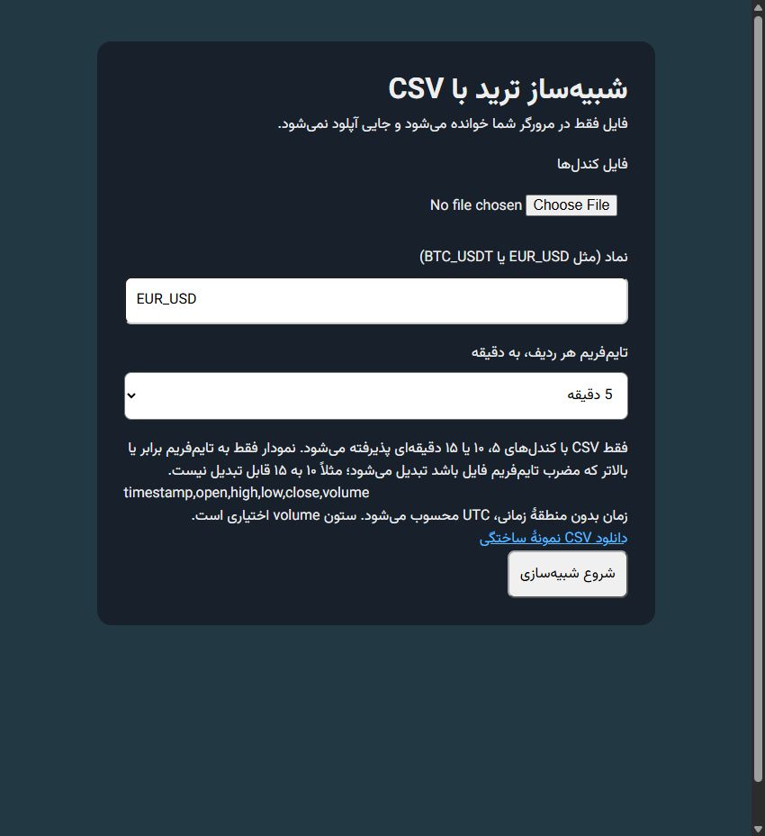

<div align="center">

# CSV Trade Simulator

### Your candles. Your chart. Your trading practice.

**A complete CSV replay workspace for chart analysis, simulated orders and trading review.**

[فارسی](README.fa.md) · [Quick start](#quick-start) · [Order types](#eight-order-combinations) · [CSV format](#bring-your-own-data)



</div>

## Turn your CSV into a trading desk

Stop staring at rows of historical prices. Load your candles, replay the market, plan entries, manage risk and review your decisions — all in your browser.

For traders who use TradingView mainly for **charting, technical analysis and manual replay practice**, this panel covers a large share of those everyday needs in one focused workspace: familiar drawing tools, 36 built-in indicators, multi-timeframe charts, a simulated order desk and a detailed journal. Bring your own data and practice at your own pace, without an account, backend or market-data API key.

Built with TradingView Lightweight Charts. This independent project is not affiliated with or endorsed by TradingView; it does not include TradingView's live feeds, Pine Script or brokerage integrations.

## What you get

- **Candle-by-candle replay:** play, pause, step forward/backward and choose 1×, 2×, 5×, 10× or 20× playback steps. Rewind restores trading timeline snapshots.
- **A proper simulated order desk:** buy/sell, four order families, optional stop loss and take profit, lot sizing and margin estimates.
- **Hands-on position management:** close a position, close 25% / 50% / 75% or a custom size, cancel pending orders and adjust trade levels on the chart.
- **36 technical indicators:** moving averages, volatility bands, trend systems, momentum oscillators and volume studies.
- **Drawing and analysis tools:** trend lines, rays, horizontal/vertical lines, channels, pitchforks, Fibonacci tools, patterns, long/short position drawings, text, brush and range measurements.
- **Your session, your rules:** initial balance, leverage, spread and replay starting date.
- **Multi-timeframe analysis:** import 5-, 10- or 15-minute bars and aggregate them into compatible higher timeframes.
- **Trading review:** journal, balance curve, win rate, profit factor, drawdown, expectancy, risk/reward and breakdowns by direction, order type, exit reason, weekday and hour.
- **Take your results with you:** journal CSV/JSON, Excel-compatible report export, browser print/save as PDF and shareable report links.
- **Local-first:** CSV data is read in browser memory. No account, server-side upload or API key. Responsive layout, light/dark application themes and a Persian trading interface.

## Eight order combinations

| Family | Buy | Sell | How it works in the simulator |
| --- | --- | --- | --- |
| Market | Market Buy | Market Sell | Enter at the current simulated quote. |
| Limit | Buy Limit | Sell Limit | Wait for your chosen entry price. |
| Stop | Buy Stop | Sell Stop | Activate when the trigger price is reached. |
| Stop-Limit | Buy Stop-Limit | Sell Stop-Limit | Reach a stop trigger, then work a limit entry. |

Optional **SL/TP**, spread-aware bid/ask execution, pending-order cancellation, full/partial closing and editable price levels complement the order desk. These are simulated orders; no live trade is sent.



## 36 built-in indicators

**Trend & overlays:** SMA, EMA, WMA, HMA, VWMA, VWAP, Bollinger Bands, Bollinger Band Width, Keltner Channels, Donchian Channels, Ichimoku Cloud, Parabolic SAR and Supertrend.

**Momentum, volatility & volume:** RSI, Stochastic, Stochastic RSI, MACD, ADX/DMI, ATR, CCI, Williams %R, ROC, Momentum, MFI, OBV, Accumulation/Distribution, Chaikin Oscillator, Chaikin Money Flow, Volume, Volume Oscillator, Awesome Oscillator, TRIX, DPO, PPO, Aroon and Ultimate Oscillator.



## Review the decisions behind the trades

A chart tells you what price did. The report helps you inspect what **you** did: entry/exit details, balance progression, drawdown, winning/losing streaks, trade duration and how results differ by order type and timing.



*Screenshots use the included synthetic dataset and demonstration trades. Displayed results illustrate the interface, not a strategy's performance.*

## Quick start

Requires **Node.js 22.18+ or Node.js 24**, with npm.

```sh
git clone https://github.com/AhmadrezaGholizade/csv-trade-simulator.git
cd csv-trade-simulator
npm ci
npm run dev
```

1. Open the local URL printed by Vite.
2. Choose a CSV from the import screen, enter its symbol (for example `EUR_USD` or `BTC_USDT`) and select **5, 10 or 15 minutes** as the source interval.
3. Set balance, leverage, spread and the starting date, then begin your session.
4. Replay candles, add indicators, draw your plan and place simulated orders.
5. Review and export the journal/report.

Try [the included synthetic EUR/USD sample](public/examples/sample.csv) with **EUR_USD / 5 minutes**. It contains 2,400 generated candles; no real market history is bundled.



## Bring your own data

```csv
timestamp,open,high,low,close,volume
2025-01-06T00:00:00Z,1.08000,1.08020,1.07990,1.08010,100
2025-01-06T00:05:00Z,1.08010,1.08030,1.08000,1.08020,120
```

- Required columns: timestamp (`ts`, `datetime`, `date` or `time` are also accepted), open, high, low, close. Volume is optional.
- Comma, semicolon and tab separators, quoted single-line fields, UTF-8 BOM and MetaTrader `<DATE>` / `<TIME>` headers are supported.
- Use ISO timestamps, Unix seconds/milliseconds, or `YYYY.MM.DD` with a separate time column. Times without a zone are interpreted as UTC.
- Rows are sorted. Duplicate timestamps, invalid prices, inconsistent OHLC, negative volume and incompatible row intervals are rejected.
- Source interval: **5 / 10 / 15 minutes only**. Conversion is allowed only to the same interval or an integer multiple: 5→10/15/30 works; 10→15 does not; 15→5 does not. Unavailable chart intervals are disabled.
- Aggregation uses UTC buckets. Gaps are not filled and edge buckets can be partial.

## Development & static hosting

```sh
npm test
npm run build
npm run preview
```

Tests cover CSV validation/aggregation, indicator calculations, order validation and playback execution. CI runs tests and the production build on pushes and pull requests.

The production site is `dist/`. Deploy its contents to any static host, including GitHub Pages. Relative asset paths and hash routing support repository subpaths. The application uses React, TypeScript, Vite, Zustand and Lightweight Charts.

## Session behavior & simulation scope

The dataset, trades and session are kept in memory and clear on reload; chart preferences may persist locally. Changing chart timeframe starts a fresh trading timeline. Report links contain trade details, so share them intentionally.

Execution uses deterministic OHLC-based rules rather than tick data. When both SL and TP are touched in one candle, SL has priority. Fees, funding and live execution conditions are not modeled. Profit/margin multipliers and price precision are defined in `src/lib/marketConfig.ts`; the inherited profit multiplier is 1000 and should be adjusted for your instrument's contract specification before comparing monetary results with a broker account.

See [third-party notices](THIRD_PARTY_NOTICES.md) for dependency and asset attribution. Public source availability does not replace third-party licensing terms. No project-wide reuse license is granted yet.

---

If this helps your practice routine, **star the repository**, try it with your own CSV and share an issue with reproducible feedback.
